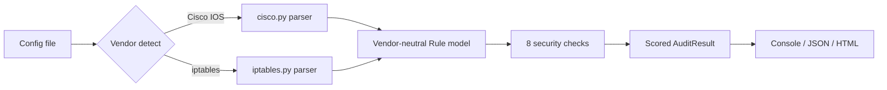

# fwaudit: Firewall Rule Validator & Hardening Auditor

   

A zero-dependency Python CLI that parses **Cisco IOS ACLs** and **iptables** rule sets, flags risky misconfigurations, scores the result, and produces auditor-friendly reports (console, JSON, HTML), with every finding mapped to **NIST 800-53, ISO 27001, PCI DSS and CIS Controls**.

Built to mirror how an IT auditor or security engineer actually reviews a perimeter: find the dangerous rules, explain *why* they matter, say how to fix them, and give evidence you can paste into a working paper.

## Why this exists

Manual firewall reviews are slow, inconsistent and hard to repeat. `fwaudit` turns the review into a repeatable control test:

- **Repeatable**: same input, same findings, every time
- **Explainable**: each finding cites the exact rule, line number, remediation and framework reference
- **Pipeline-ready**: `--fail-on high` returns a non-zero exit code so a CI job can block risky firewall changes

## Quick start

```bash
git clone https://github.com/YOUR-USERNAME/cybersecurity-portfolio.git
cd cybersecurity-portfolio/01-firewall-rule-auditor
pip install -e .            # or just run: python -m fwaudit ...

fwaudit audit samples/cisco_edge_bad.cfg
fwaudit audit samples/iptables_bad.rules -f html -o report.html
fwaudit audit /etc/iptables/rules.v4 --fail-on high      # CI gate
```

Export an iptables ruleset with `iptables-save > rules.v4`; for Cisco use `show running-config`.

## What it detects

| ID | Check | Severity |
|---|---|---|
| FW-001 | Permit any-any rule | Critical |
| FW-002 | Risky service exposed to *any* source (Telnet, RDP, SMB, SNMP, DBs, Docker API, ...) | Medium to Critical (per service) |
| FW-003 | Overly broad permit (all ports, or >1000-port range) from any source | High |
| FW-004 | Default-permit posture / missing explicit deny-all | High (iptables) / Low (Cisco) |
| FW-005 | Deny-all rule not logged | Low |
| FW-006 | Shadowed rule (dead rule, or conflicting action) | High if conflicting, else Low |
| FW-007 | ACL defined but never applied | Low |
| FW-008 | ICMP from any without type restriction | Low |

Scoring: start at 100, subtract 30 / 12 / 5 / 2 per Critical / High / Medium / Low finding. Grades A to F.

## Example output

```text
fwaudit 0.1.0  cisco_edge_bad.cfg [cisco]
17 rules analysed | score 0/100 | grade F
Critical: 3  High: 3  Medium: 1  Low: 5  Info: 0

 CRITICAL FW-002  Risky service exposed to any source: Telnet  @ OUTSIDE_IN#3 (line 7)
           OUTSIDE_IN #3 exposes Telnet (23/tcp) to any source address.
           > permit tcp any any eq telnet
           Fix: Restrict the source to a management/trusted network or VPN, or remove the rule. Replace cleartext protocols (Telnet, FTP, TFTP, SNMPv1/2c) with encrypted alternatives.

 CRITICAL FW-002  Risky service exposed to any source: RDP  @ OUTSIDE_IN#5 (line 9)
           OUTSIDE_IN #5 exposes RDP (3389/tcp) to any source address.
           > permit tcp any host 203.0.113.20 eq 3389
           Fix: Restrict the source to a management/trusted network or VPN, or remove the rule. Replace cleartext protocols (Telnet, FTP, TFTP, SNMPv1/2c) with encrypted alternatives.

 CRITICAL FW-001  Permit any-any rule  @ OUTSIDE_IN#10 (line 14)
           OUTSIDE_IN #10 permits all protocols from any source to any destination, which effectively disables filtering for this list.
           > permit ip any any
           Fix: Remove the rule. Permit only the specific sources, destinations and services required, and end the list with an explicit deny.

 HIGH     FW-002  Risky service exposed to any source: SNMP  @ OUTSIDE_IN#6 (line 10)
           OUTSIDE_IN #6 exposes SNMP (161/udp) to any source address.
           > permit udp any any eq snmp
```

A full HTML report is in [`docs/sample_report_cisco.html`](docs/sample_report_cisco.html) (open it in a browser; it supports light and dark mode).

## How it works



- **Normalisation**: both vendors parse into one `Rule` model (action, protocol, CIDR source/destination, port ranges), so every check is written once.
- **Shadow detection** uses real subnet containment (`ipaddress`) and port-range set logic, not string matching.
- **Conservative by design**: rules with match conditions the tool can't model (interface, rate limits, negation) are marked `complex` and never trigger any-any or shadow findings, to avoid false positives like loopback accept rules.
- **Safe output**: all config-derived text is HTML-escaped in reports (covered by a regression test).

## Known limitations (honest scope)

- Cisco object-groups are skipped with a parser warning (no silent misparse).
- IPv4 only. `ip6tables` and IPv6 ACLs are not yet parsed.
- iptables `-I` is treated as append, with a warning.
- Direction is inferred from interface bindings (Cisco) or chain (iptables). An unbound ACL is treated as potentially inbound.
- Framework mappings are indicative; validate them against your organisation's control library.

## Tests

```bash
pip install -e ".[dev]"
pytest -q
```

19 tests cover parsers, address/port maths, each check (including false-positive guards), CLI exit codes, JSON output and HTML escaping.

## Roadmap

- [ ] Palo Alto, Fortinet and AWS Security Group parsers
- [ ] Object-group resolution for Cisco
- [ ] SARIF output for GitHub code scanning
- [ ] Baseline/diff mode ("what changed since last audit?")

## Skills demonstrated

Network security (ACLs, stateful filtering) · IT general controls and perimeter assessment · secure-by-default parsing · framework mapping (NIST, ISO 27001, PCI DSS, CIS) · testing and CI.
