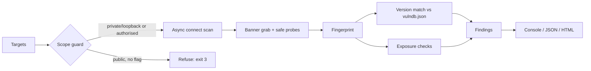

# netrecon: Async Network Service Mapper & Vulnerability Scanner

   

A zero-dependency, `asyncio`-based TCP scanner that discovers open ports, identifies the services behind them, and flags **known-vulnerable versions** and **risky exposures** (unauthenticated Redis, Telnet, exposed Docker API, EOL software...). Includes a built-in **safe lab** so anyone can run it without touching a real network.

> **Ethics & legality first.** Only scan systems you own or have **written authorisation** to test. `netrecon` enforces this by design: it refuses publicly routable targets unless you pass `--i-have-written-authorization`, caps host counts, and performs only read-only probes (no exploits, no credential guessing).

## Quick start

```bash
cd 02-network-scanner
pip install -e .

# 1. start the harmless lab (fake vulnerable-looking services on 127.0.0.1)
python lab/fake_services.py &

# 2. scan it
netrecon scan 127.0.0.1 -p 2121,2222,2323,2525,3307,6380,8080
netrecon scan 127.0.0.1 -p 2121,2222,2323,2525,3307,6380,8080 -f html -o report.html

# scan your own LAN segment (private ranges allowed by default)
netrecon scan 192.168.1.0/24 -p top --fail-on high
```

## Features

| Capability | Detail |
|---|---|
| **Async connect scan** | Correct state semantics: `open` (handshake), `closed` (RST, host up), `filtered` (timeout/unreachable) |
| **Flexible targets** | IP, CIDR, `10.0.0.5-20`, hostnames, `@targets.txt` |
| **Banner grabbing** | Passive read first (SSH/FTP/SMTP/MySQL/Telnet), then safe read-only probes (HTTP GET, Redis `PING`, memcached `version`), TLS-aware |
| **Fingerprinting** | SSH, HTTP (`Server`, `X-Powered-By`), FTP, SMTP, POP3/IMAP, MySQL/MariaDB handshake parsing, Redis, memcached, VNC, Telnet, Elasticsearch, Docker |
| **Vulnerability matching** | Local JSON knowledge base with proper version-range logic (`8.5 <= v < 9.8`, multi-branch ranges) |
| **Exposure checks** | 15 checks, e.g. unauthenticated Redis, exposed Docker API, Telnet, cleartext FTP, RDP/SMB, DB listeners |
| **Honest confidence** | Version matches are `medium`; banners from Ubuntu/Debian/RHEL builds drop to `low` because distros backport fixes |
| **Reporting** | Console, JSON, self-contained HTML (dark/light) |
| **CI gating** | `--fail-on high` exit codes |

Speed reference (my sandbox, loopback only, so not representative of real networks): 20,000 ports in about 1.5 s at 300 concurrent connections.

## Sample output

```text
netrecon 0.1.0  1 host(s) scanned, 1 up, 7 open port(s)
Critical: 4  High: 4  Medium: 4  Low: 1  Info: 0

127.0.0.1   closed 0 / filtered 0
  PORT      SERVICE       VERSION                   BANNER
  2121/tcp  ftp           vsftpd 2.3.4              220 (vsFTPd 2.3.4)
  2222/tcp  ssh           OpenSSH 7.4               SSH-2.0-OpenSSH_7.4
  2323/tcp  telnet                                   login: 
  2525/tcp  smtp          Exim 4.90                 220 mail.lab ESMTP Exim 4.90 ready
  3307/tcp  mysql         MySQL 5.5.20              J....5.5.20-log
  6380/tcp  redis         Redis                     +PONG
  8080/tcp  http          Apache httpd 2.4.49       HTTP/1.1 200 OK..Server: Apache/2.4.49 (Unix)..X-Powered-By:

 CRITICAL CVE-2011-2523  vsftpd 2.3.4 backdoor  @ 127.0.0.1:2121  confidence=medium
```

Full HTML report: [`docs/sample_report.html`](docs/sample_report.html).

## Architecture



- `scanner.py`: worker-pool over a shared `itertools.product` iterator, so a /24 x 1000 ports never builds hundreds of thousands of tasks
- `banner.py`: passive-first strategy; unknown silent ports get HTTP then Redis probes; stops at the first response that fingerprints
- `versions.py`: tolerant parser for `8.9p1`, `2.4.49`, `4.91`; padded tuple comparison
- `data/vulndb.json`: add a vulnerability by adding one JSON object (id, product, affected ranges, remediation, references)

## Design decisions worth discussing in an interview

1. **Connect scan instead of SYN scan.** No root or raw sockets needed, portable, and more than enough for service mapping. The trade-off is that it is noisier in target logs.
2. **Confidence levels.** Banner-based CVE matching is an *indication*, not proof. The tool says so, and downgrades distro builds instead of crying wolf. Severity labels are my triage ratings; use NVD for authoritative CVSS.
3. **Safe by default.** Scope guard, host cap, no exploitation, no auth attempts. Security tooling should model the behaviour it expects from users.
4. **Hostile input handling.** Banners come from untrusted servers, so every field is escaped in HTML and non-printables are stripped. A regression test serves a `<script>` banner.

## Known limitations

- TCP only (no UDP); IPv4 only.
- Version-based detection can't see backported patches or hidden/modified banners; treat `low`/`medium` findings as leads to verify.
- The bundled vulnerability DB is deliberately small and curated (12 entries); extend it or feed it from NVD for production use.
- TLS handling captures protocol version but does not yet analyse certificates or cipher suites.
- A firewall that silently drops probes shows ports as `filtered`, so results depend on your network vantage point.

## Tests

```bash
pip install -e ".[dev]"
pytest -q
```

21 tests: version boundaries (including the OpenSSH regreSSHion range edges), port/target parsing, scope-guard refusal, every fingerprint family, confidence downgrading, an **end-to-end scan of the lab**, closed/open state correctness, hostile-banner escaping, and CLI exit codes.

## Roadmap

- [ ] UDP probes (DNS, SNMP, NTP)
- [ ] TLS certificate and cipher analysis
- [ ] NVD JSON feed importer for `vulndb.json`
- [ ] Diff mode: "new open ports since last scan"
- [ ] SARIF output

## Skills demonstrated

Network protocols and socket programming · `asyncio` concurrency · reconnaissance methodology · vulnerability management · secure tool design (scope control, hostile-input handling) · testing with realistic fixtures.
